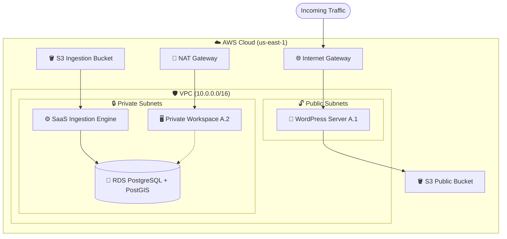

# 🛰️ ASTERRA DevOps Technical Assignment - End-to-End Guide

Welcome to the production deployment repository for the ASTERRA DevOps engineering evaluation. This system sets up a completely automated Cloud Ingestion and Application Delivery framework optimized to run inside the AWS Free Tier.

---

## 🏗️ System Architecture



### 🧱 Core Components

1. **Network Layer (VPC):** Spans two Availability Zones. Public subnets host incoming web requests, while private subnets isolate core compute and the stateful database layer.
2. **PaaS Component (A.1):** A public WordPress server deployed via Docker-Compose on Amazon Linux 2023, open on standard port 80.
3. **Private Workspace (A.2):** An isolated EC2 instance configured with a desktop environment (XFCE) and XRDP for secure spatial vector data validation using local `GDAL` and `GeoPandas` tools.
4. **SaaS Core Application:** A background daemon packaged as a Docker container. It continuously polls an isolated private S3 Ingestion Bucket, validates incoming `.geojson` files, and streams spatial vector entries directly into PostgreSQL via native `PostGIS` functions (`ST_GeomFromGeoJSON`).

---

## 🛠️ Tech Stack & Ecosystem

<p align="left">
  
  
  
  
  
  
</p>

---

## 🚀 Step-by-Step Execution Plan

Follow these exact steps to launch, test, and destroy the environment.

### Phase 1: Local Infrastructure Provisioning

1. Ensure your local terminal is configured with valid administrative AWS credentials:
   ```bash
   aws configure
   ```
   
2. Navigate to the automation folder, make the scripts executable, and run the deployment:
   ```bash
   cd scripts
   chmod +x deploy.sh destroy.sh
   ./deploy.sh us-east-1
   ```

**What happens here?** The script auto-boots a dedicated S3 state-backend bucket, initialises Terraform, spins up the entire AWS topology, and uploads the project half-pager.md directly onto the public delivery asset block.

### Phase 2: Wire up the CI/CD Pipeline

1. Take the generated ECR Repository URL from the Terraform outputs.
2. Push this codebase to your private GitHub Repository.
3. Add your AWS access tokens into the GitHub Repository Secrets under:
   * `AWS_ACCESS_KEY_ID`
   * `AWS_SECRET_ACCESS_KEY`
4. Make a commit or merge into the `main` branch. This triggers the GitHub Actions workflow, automatically auto-increments the semantic version tag, compiles the Docker container, and pushes it to AWS ECR.
5. The private EC2 instance (`gis_private`) will detect the new image automatically via its internal systemd service loop, pull down the container safely, and begin active processing.

---

## 🧪 Functional Verification & Testing Flow

To prove to the reviewers that the ingestion core works perfectly, run this simulation:

### 1. Verify the Public WordPress Platform
* Grab the `wordpress_public_ip` from the Terraform console output.
* Open a web browser and navigate to: `http://<YOUR_WORDPRESS_PUBLIC_IP>`
* **Expected result:** The standard WordPress installation page loads immediately.

### 2. Test the GeoJSON Ingestion Flow
* Create a dummy spatial file locally named `test_location.geojson`:
  ```json
  {
    "type": "FeatureCollection",
    "features": [
      {
        "type": "Feature",
        "properties": { 
          "location_name": "Asterra HQ Israel", 
          "status": "Active" 
        },
        "geometry": { 
          "type": "Point", 
          "coordinates": [34.9012, 32.1845] 
        }
      }
    ]
  }
  ```

* Upload this file to your newly created private S3 ingestion bucket:
  ```bash
  aws s3 cp test_location.geojson s3://asterra-prod-geojson-ingest-data-2026/
  ```

* **Verification:** Connect to your private instance or review database tables. The SaaS Engine container will automatically download the file, parse the schema, and store it in the `asterra_spatial_features` database matrix using PostGIS coordinates.

---

## 🧹 One-Click Teardown (Cost Protection)

To avoid unexpected bills or lingering active resources in your AWS account, run the destruction protocol:
```bash
cd scripts
./destroy.sh us-east-1
```

> ⚠️ **Warning:** This forces immediate cascading removal of all buckets, databases, computing instances, networks, and secrets.
